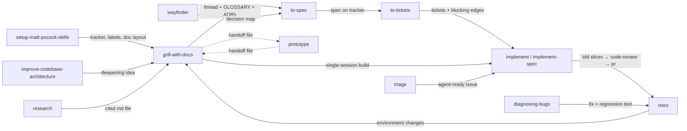

# Matt Pocock skills workflow

- Source: mattpocock-skills, pinned commit `49dd158d1076134a641b33efb035946536778336`
- Shape: one main pipeline by phase (idea → ship), with three on-ramps, an upkeep loop, and a vocabulary layer underneath. Matt presents each piece as small, composable and optional, not as a process that owns the work (`README.md`, intro).

## Purpose

Who it is built for and what the human keeps (ADR 0010).

- Built for a human engineer who stays the engineer: "My agent skills that I use every day to do real engineering - not vibe coding" (`README.md`).
- The human keeps control and understanding: other approaches "take away your control and make bugs in the process hard to resolve"; grilling helps you "think deeply about the change you're making" (`README.md`, intro and #1).
- The human keeps the design: shared language in `GLOSSARY.md`, ADRs, deep modules, "caring about the design of the code" (`README.md` #2, #4).

## Stance

Where trust in the work comes from. *(Claude's framing)*

- Trust is built **before** the code: align by interview, write a spec, split into tickets, then review the diff against that spec (`code-review` Spec axis).
- Proof during the build comes from feedback loops the human sets up: TDD at seams the user confirms, static types, tests (`README.md` #3; `tdd/SKILL.md`).
- The human makes every decision; the agent finds facts (`grilling/SKILL.md`).
- Context: the user decides at phase boundaries; reasoning stays first-hand in one window through grill → spec → tickets (dimension 10).
- No offline mode: only tightly scoped AFK tasks go to a subagent (dimension 16).

## Problems it solves

Matt's README ("Why These Skills Exist", #1–#4) names four failure modes. Rows marked *(inferred)* are problems Claude framed from the flow described in `skills/engineering/ask-matt/SKILL.md`. Matt does not list them as problems.

| Problem | Fixed by (skills / steps) | How | Kind of work |
|---|---|---|---|
| P1. The agent didn't do what I want (misalignment) | `grill-me`, `grill-with-docs`, `grilling` | Agent interviews the user until every branch of the design tree is resolved; used before every change (`README.md` #1) | development |
| P2. The agent is too verbose (no shared language) | `grill-with-docs`, `domain-modeling`, `wait-what` | Builds `GLOSSARY.md` and ADRs inline so one term replaces twenty words; `wait-what` re-pitches a message that didn't land (`README.md` #2) | development |
| P3. The code doesn't work (no feedback loops) | `tdd`, `diagnosing-bugs`, `code-review` | Red-green-refactor slices; bug diagnosis gated on a loop that goes red on this bug; review against standards and spec (`README.md` #3) | development |
| P4. We built a ball of mud (entropy) | `to-spec` (quizzes which modules are touched), `improve-codebase-architecture`, `codebase-design` | Deep-module vocabulary at every layer; a survey every few days for deepening opportunities (`README.md` #4) | maintenance |
| P5. Context lost between sessions and phases *(inferred)* | Phase-boundary tree, `handoff`, self-contained tickets | Decide continue / clear / handoff / subagent / compact only at a phase boundary (`ask-matt/PHASE-BOUNDARIES.md`) | development |
| P6. Work too big for one session *(inferred)* | `wayfinder`, `to-spec` → `to-tickets`, `implement-spec` | Decision-ticket map on the tracker; tickets with blocking edges, worked one per session or as a parallel task graph (`ask-matt/SKILL.md`) | development |
| P7. Raw incoming issues pile up *(inferred)* | `triage` | Moves issues through triage roles into agent-ready issues (`ask-matt/SKILL.md`, On-ramps) | maintenance |
| P8. The agent's environment never improves *(inferred)* | `retro` | After a session, suggests environment changes: mechanical mistakes → checks, judgement calls → coding standards (`ask-matt/SKILL.md`, step 4) | maintenance |
| P9. Steps only a human or another person can do *(inferred)* | `wizard`, `to-questionnaire` | Bash wizard for human-only steps; a questionnaire for the one person who holds the answer (`ask-matt/SKILL.md`, Standalone) | development |

## Entry points

- **User-invoked** skills (`disable-model-invocation: true`) orchestrate: `ask-matt`, `grill-with-docs`, `grill-me`, `to-spec`, `to-tickets`, `implement`, `implement-spec`, `wayfinder`, `triage`, `improve-codebase-architecture`, `retro`, `handoff`, `teach`, `to-questionnaire`, `wait-what`, `setup-matt-pocock-skills`.
- **Model-invoked** skills hold reusable discipline and can also be typed: `grilling`, `tdd`, `diagnosing-bugs`, `code-review`, `pr`, `prototype`, `research`, `domain-modeling`, `codebase-design`, `wizard`, `writing-for-agents`.
- Rule: a user-invoked skill may call model-invoked skills, never another user-invoked one (`README.md`, Reference).
- `ask-matt` is a router the user asks when unsure which skill fits.
- Precondition: `setup-matt-pocock-skills` runs once per repo (issue tracker, triage labels, doc locations).
- Out of this profile: `skills/in-progress/`, `skills/misc/`, `skills/deprecated/` (not part of the documented flows).

## Flow

## Steps

| Step | Skill / mechanism | Input | Output | Who triggers |
|---|---|---|---|---|
| 0. Setup | `setup-matt-pocock-skills` | repo | tracker, labels, doc layout config | user, once per repo |
| 1. Align | `grill-with-docs` (runs `grilling`, `domain-modeling`) | idea | resolved decisions, `GLOSSARY.md`, ADRs | user |
| 2. Detour (optional) | `handoff` → `prototype` → `handoff` | unresolved design question | answer; prototype kept on a `prototype/<name>` branch | user / model |
| 3a. Spec | `to-spec` | the conversation (no new interview) | spec on the tracker | user |
| 3b. Tickets | `to-tickets` | spec, plan or conversation | tracer-bullet tickets with blocking edges | user |
| 4. Build | `implement` (per ticket, `/clear` between) or `implement-spec` (parallel subagents, one integration branch) | ticket(s) or, for single-session work, the conversation | code via `tdd`, checked by `code-review` | user |
| 5. PR | `pr` | change | PR body: smallest visual, before/after evidence, one-way/two-way door call | model |
| 6. Retro | `retro` | session (or its log) | environment improvements, most severe first | user |

Context hygiene: steps 1–3 stay in one unbroken context window; each `implement` starts fresh from its ticket; `retro` runs in the session it reviews, before clearing (`ask-matt/SKILL.md`).

## User checkpoints

- **Decide**: every grilling round. Facts are the agent's job, decisions are the user's (`ask-matt/SKILL.md`, Standalone: `grilling`).
- **Decide**: at each phase boundary, which of the five context moves to make.
- **Decide**: multi-session build or not (branch at step 3).
- **Pick**: one candidate from the `improve-codebase-architecture` HTML report, then grill through it.
- **Approve** *(inferred)*: the spec and tickets before implementation, and the PR (Matt's skills publish to the tracker; the read did not show an explicit approval gate here).
- **Act**: human-only steps via `wizard`; another person's answers via `to-questionnaire`.

## Loops

- `tdd`: red → green → refactor, one vertical slice at a time.
- `diagnosing-bugs`: feedback loop → minimise → hypothesise → instrument → fix → regression test.
- `code-review` → fix, before committing.
- `retro` → environment changes → better next build.
- `diagnosing-bugs` → `retro` → `improve-codebase-architecture` when the finding is "no good seam".
- `improve-codebase-architecture` → new idea → back into `grill-with-docs` (a key loop beside the main flow; user position held in `docs/status.md`).
- `wayfinder`: resolve decision tickets one at a time until the map clears, then hand off to `to-spec`.

## Coupling

Dimension numbers refer to `docs/dimensions.md`. Labeled *(inferred)* where Claude drew the link.

- **1, 3, 6**: confirmed. User as decider, heavy planning, and spec/ticket artifacts form one package; `implement` consumes tickets, so dropping `to-spec`/`to-tickets` leaves multi-session builds without input (`ask-matt/SKILL.md`, step 3).
- **6, 10**: `/clear` between tickets only works because each ticket is self-contained (`ask-matt/SKILL.md`, step 3).
- **3, 8**: `code-review`'s Spec axis needs an originating spec or issue to review against (`README.md`, Reference).
- **4, 11** *(inferred)*: `wait-what` and the concise vocabulary depend on the `GLOSSARY.md` that `grill-with-docs` builds; using `grill-me` instead leaves no glossary.
- **2, 14, 15**: the user-invoked/model-invoked split is how orchestration (process) is separated from discipline (reference); the no-nesting rule keeps orchestrators from calling each other (`README.md`, Reference).
- **13, 6**: `setup-matt-pocock-skills` must run first; `triage`, `to-spec` and `to-tickets` assume its tracker and label config.

## Inferences

- Problems P5–P9 are Claude's framing of flows in `ask-matt`; Matt names only #1–#4 as problems.
- The approval checkpoints on spec, tickets and PR are inferred, not read as explicit gates.
- Coupling 4/11 is inferred.
- Drawn as one pipeline, the flow looks rigid; Matt's intent is that each skill can be used alone (`tdd` and `code-review` explicitly, per `ask-matt/SKILL.md`).
