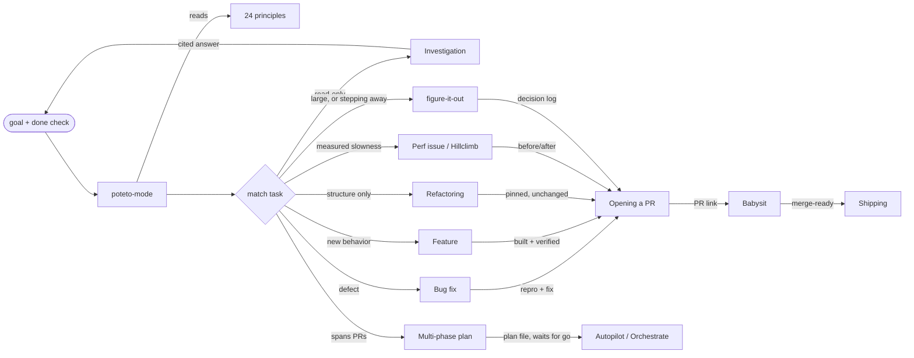

# pstack workflow

- Source: pstack (standalone mirror `backnotprop/pstack` of `cursor/plugins/pstack`), pinned commit `6f131f137de64fdaf928278c0fd9ecec520ccbee`
- Shape: a router dispatching to playbooks. One mode skill (`poteto-mode`) matches the task to one of 23 playbooks, copies its steps into the todo list, and pulls in other skills and 24 one-rule principles as the steps fire. There is no planning step by default (`README.md`, "why are there no planning skills?").
- Reading coverage: README, all 11 guide pages, `poteto-mode` and 19 playbooks, 29 standalone skills, 24 principles and both agents read in full or close to it. Skimmed only: `orchestrate`, `autopilot-full`, `autopilot-stack`, `worktree-cleanup`, the `benny` automation pack, and most `references/` files.

## Purpose

Who it is built for and what the human keeps (ADR 0010).

- Built for an operator who delegates as much as possible: "stop micromanaging the agent" (`docs/guide/README.md`); "fearless parallelism ... start multiple agents up with `poteto-mode`" (`README.md`).
- The human keeps goals and judgment calls: "Product direction comes from the human. Execution should not block" (`principle-never-block-on-the-human`).
- Quality is the condition for delegating: "throughput without quality is not a goal ... if you want to go fast, go deep first" (`README.md`).

## Stance

Where trust in the work comes from. *(Claude's framing)*

- Trust is built **after** the code, by independent proof: the writer is never the judge (Shipping verifiers, `no-comments`, `arena` cross-judge), different model families review the same work (`interrogate`), and "done" means evidence from the real app (`principle-prove-it-works`, `create-verification-skill`).
- Claims are labeled: "Every claim carries its evidence or its label in the same sentence. Measured, inferred, or guess" (`poteto-mode`, Writing the reply).
- Supervision is replaced by audit: a decision log with an "Attention" section from a reviewer on another model (`show-me-your-work`).
- Context: the main chat coordinates and works mostly from subagent summaries; state lives in files (dimension 10).
- Weaker on "is this the right feature": `architect` skips the design checkpoint by default, and there is no review against a spec, only against the prompt's done condition. *(inferred)*

## Problems it solves

pstack has no failure-mode section like Matt's README. It names problems in the README intro and across the guide pages; each row cites where. "Shared #" links to the list in `docs/dimensions.md`.

| Problem | Fixed by (skills / steps) | How | Kind of work | Shared # |
|---|---|---|---|---|
| AI writes too much slop code; throughput without quality (`README.md`, intro) | Laziness Protocol, Subtract Before You Add, Minimize Reader Load principles; `unslop`; `no-comments`; `deslop` (not shipped) | Bias toward deletion and the smallest change; a separate reviewer strips comments; prose cleaned of AI tells | development | P10 (new) |
| The agent misreads what you want (`docs/guide/03-understand.md`; prompt shape in `02-poteto-mode.md`) | goal + done check in the prompt; "restate in your own words" step; `in-your-own-words`; `sharpen` | The prompt carries a pass/fail check; the agent restates the problem before code | development | P1 |
| The agent lacks the context to do the work right (`03-understand.md`) | `how`, `why`, `teach`, `recall`; Session pickup playbook | Read-only explorers explain the subsystem; `why` searches git, tickets, docs, chat and observability in parallel | development | P11 (new) |
| Taking the first design, or polishing a plan no code has tested (`04-design.md`) | `architect` (runs `how` + `arena`), `arena`, Prototype playbook, `interrogate` on diffs | Several models sketch competing designs; a judge on another model picks a base; open questions settled by running code | development | P12 (new) |
| "It compiles" is not evidence; verification waits on a human (`06-verify-and-ship.md`) | Prove It Works principle, `create-verification-skill`, `maintain-verification-skill`, `blast-radius`, Shipping verifiers | A project-local skill drives the real app; a fresh agent that didn't write the code gives the verdict | development | P3 (broadened) |
| Faked or misleading numbers (`06-verify-and-ship.md`) | `benchmark-checklist`, Explain the Number principle | Seven evidence questions before a number is reported | development | P3 (sub-point) |
| Loops produce unchecked work faster; unattended work can't be audited (`07-overnight.md`) | finish predicate, Autonomous run playbook, `figure-it-out`, `show-me-your-work` (cross-model trail review) | Every iteration makes one change, verifies, commits or discards, logs one row; a reviewer on another model reads the trail | development | P13 (new) |
| Repeating the same correction to agents (`09-make-it-yours.md`) | `correct`, `reflect`, Encode Lessons in Structure principle | Fix at the highest level that holds: architecture > types > lint > test > docs | maintenance | P8 |
| Parallel agents overwrite each other (`02-poteto-mode.md`, `10-recipes-and-pitfalls.md`) | worktree or cloud agent per worker; Separate Before Serializing Shared State principle | Each actor gets its own write target | development | P6 (sub-point) |

## Entry points

- Almost every skill is user-invoked (`disable-model-invocation: true`), including all principles. Only `typescript-best-practices` has a `paths` trigger, and it is still marked user-invoked.
- `/poteto-mode` is the front door "for any non-trivial task". In Cursor it can stay on as a Custom Mode; elsewhere you start each task with it (`docs/guide/01-setup.md`).
- `/poteto-help` routes questions to the right skill and hands back a prompt without starting the work.
- `/setup-pstack` runs once per user (not per repo): reasoning budget and a model per role, written to `~/.agents/pstack-models.md` outside Cursor. It offers `create-verification-skill` once.
- Skills can also be typed directly when you want more or less than the playbook gives (`README.md`, skills table).

## Flow

## Steps

| Step | Skill / mechanism | Input | Output | Who triggers |
|---|---|---|---|---|
| 0. Setup | `setup-pstack` | available models | model-per-role settings file | user, once |
| 1. Route | `poteto-mode` | prompt with goal and done check | matched playbook, steps copied into todo list (skips stay with `skip: <reason>`) | user |
| 2. Understand | `how`, `why` (inside playbooks) | subsystem / question | explanation with Gotchas; cited history | playbook |
| 3. Design (if crossing a function boundary) | `architect` → `arena` | grounding | synthesized type/module sketch | playbook |
| 4. Build | delegate subagent (`poteto-agent`) on the code model | scope, named data shape | diff | playbook |
| 5. Verify | control skill / `verify-<app>`, `tdd` where cheap, `benchmark-checklist` for numbers | diff | evidence (repro, screenshots, numbers) | playbook |
| 6. Clean | `deslop`, `no-comments`, `unslop` | diff, prose | clean diff and PR text | Opening a PR |
| 7. Review | `interrogate` (multi-model) when contested | diff | Act on / Consider / Noted / Dismissed | playbook |
| 8. Ship | Opening a PR → Babysit → Shipping | commits | ready PR; merge-ready; landed verified run | playbook / user |
| 9. Improve | `reflect`, `correct`, `automate-me` | transcripts, history | skill edits (after approval), repo checks, personal mode skill | user |

## User checkpoints

- **Default: don't block.** Reversible work proceeds; the human course-corrects afterward (principle `never-block-on-the-human`; `poteto-mode` Autonomy).
- **Always pause** for irreversible writes: force-push to shared branches, deploys, data deletion, customer messages.
- **Product or preference calls** no experiment can settle. A "which approach" question is first tried as a prototype.
- **Opt-in checkpoints**: `/architect with checkpoint`; "let me review before proceeding" in the prompt.
- **Approve**: `reflect` waits for approval before any skill edit; a multi-phase plan waits for an explicit go; Babysit never merges, landing is a separate request.
- **Audit after the fact**: `show-me-your-work` ends with an Attention section from a reviewer on another model.

## Offline mode

pstack plans for the user being away (dimension 16; `docs/guide/07-overnight.md`, `autonomous-run.md`).

- Before: a trust check, then a short contract (goal, pass/fail done condition, worktree, pre-answered permissions, escape hatch). A duration is not a done condition.
- During: `/loop` re-checks the predicate; one change, verify, commit or discard, one log row. Side problems are fixed in their own PRs. Irreversible actions still pause; calls only the user can make get a default and a report. Pause safely writes a resume note; Session pickup resumes from it.
- After: `show-me-your-work` with an Attention list from a reviewer on another model.
- In Claude Code, cloud agents become local worktrees, so the machine has to stay on. *(inferred from the Harness section, untested)*

## Loops

- Autonomous run: make one change, verify against the predicate, then commit or discard, log a row; a plateau means pivot, not stop.
- Hillclimb: one hypothesis per iteration against a frozen harness; keep or revert.
- Bug fix: binary-search hypotheses with runtime evidence.
- `architect` Phase E: scrap the sketch when the same workaround repeats, then re-run `arena`.
- `reflect` → skill edits; `correct` → repo checks; `maintain-verification-skill` → feature map kept honest.
- Babysit: conflicts → review threads → CI, re-armed after each push wave.

## Coupling

Dimension numbers refer to `docs/dimensions.md`.

- **1, 4, 10**: never blocking on the human only works because the prompt carries a checkable done condition and the decision log replaces live supervision (`principle-never-block-on-the-human`, `show-me-your-work`, `07-overnight.md`).
- **9, 13, 15**: multi-model review (`arena`, `interrogate`, `why`, `reflect`) depends on `setup-pstack`'s role-to-model mapping; without it every role runs on defaults.
- **3, 8**: no planning step works because prototypes and live verification do the job a spec does (`README.md`; `04-design.md`). *(inferred framing)*
- **7, 12**: `correct` ranks fixes by enforcement (architecture > types > lint > test > docs), the same ranking as Encode Lessons in Structure.
- **6, 9**: parallel workers need a worktree or cloud agent each (`principle-separate-before-serializing-shared-state`, `opening-a-pr.md`).
- **8, 9**: "the agent that judges a change is never the one that wrote it" (Shipping, `no-comments`, `show-me-your-work`) requires subagents.

## Inferences

- "No planning skills" is better read as planning by prototype and by `architect`; a Multi-phase plan playbook exists but is not a default. *(inferred)*
- Several mechanisms are Cursor-specific (cloud agents, Custom Modes, `/loop` in Cursor, `cursor-team-kit` skills, Origin forge). The mirror's Harness section in `poteto-mode` maps them to Claude Code; how well they work there is unverified.
- The default models (Opus for judgment, Grok for code) are the author's choice, not a requirement; `setup-pstack` replaces them.
- Problem framing: rows are drawn from guide pages, not a single problem list; the guide's own words are cited.
